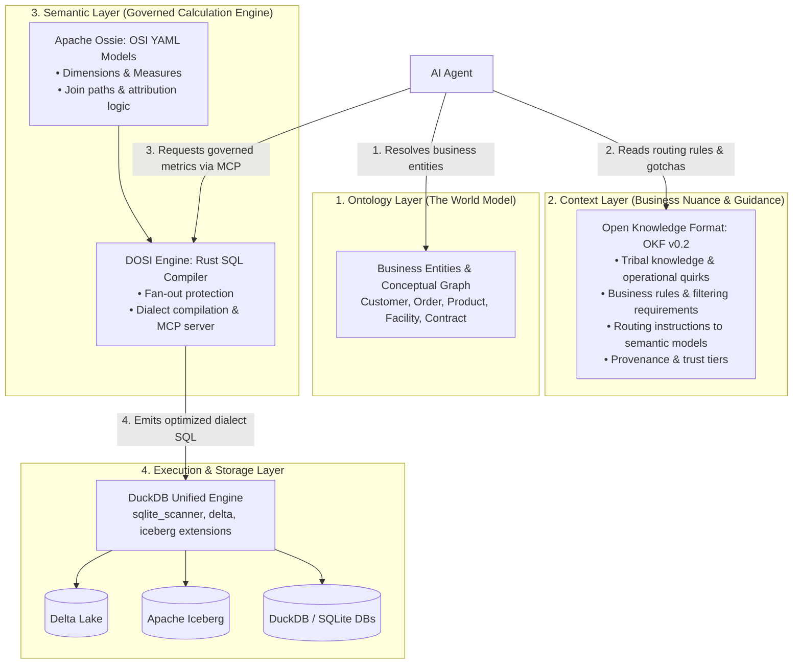
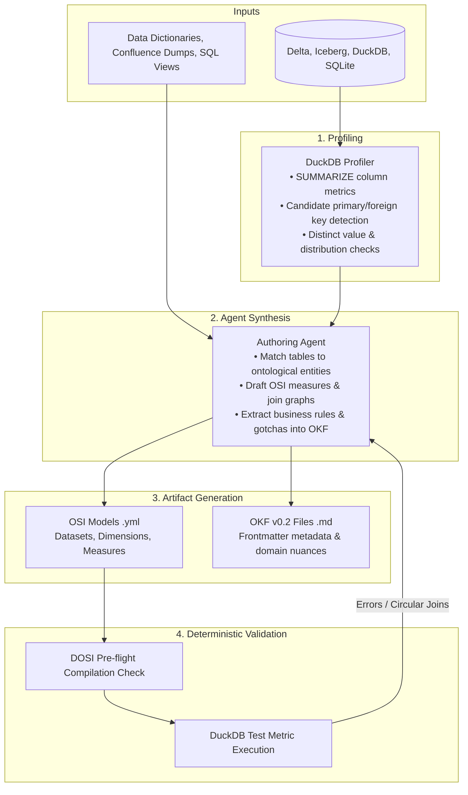
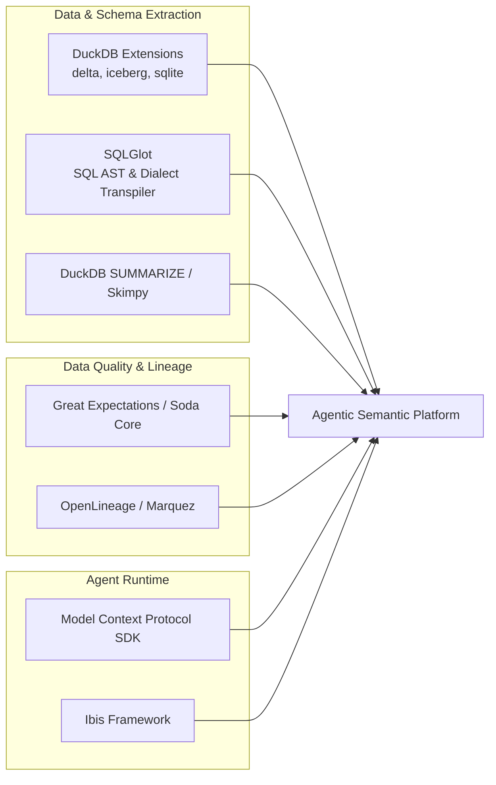

# Architecture Blueprint: 3-Tier Agentic Data Intelligence
### *Ontology, Context Layer (OKF v0.2), Semantic Layer (Apache Ossie / DOSI), and Unified Execution*

---

## 1. Executive Summary & Core Paradigm

Querying diverse, multi-engine data environments (**Delta Lake, Apache Iceberg, DuckDB, SQLite**) with autonomous AI agents requires moving beyond raw text-to-SQL. 

Direct text-to-SQL fails in enterprise settings because it conflates three fundamentally different responsibilities:
1. **Understanding what real-world entities exist** (*Ontology*).
2. **Understanding business rules, routing, and operational caveats** (*Context Layer*).
3. **Calculating governed, fan-out-safe metrics deterministically** (*Semantic Layer*).

> **Core Axiom:** *The Context Layer routes and guides; the Semantic Layer calculates and executes.*

---

## 2. The 3-Tier Architecture (MotherDuck Model)



| Layer | Responsibility | Format / Standard | Role in Agentic Workflow |
| :--- | :--- | :--- | :--- |
| **1. Ontology** | *The World Model* | Entity definitions & relations (YAML / OKF Entities) | Establishes the conceptual entities (e.g., `Customer`, `Order`, `Asset`) and how they link across distinct databases. |
| **2. Context Layer** | *The Business Guide* | **[OKF v0.2](https://github.com/google/open-knowledge-format)** (Markdown + YAML Frontmatter) | Ingests tribal knowledge, caveats, filter conditions, and routes questions to the appropriate semantic models. |
| **3. Semantic Layer** | *The Calculation Engine* | **[Apache Ossie](https://github.com/open-semantic-interchange/OSI)** + **[DOSI Engine](https://dosi.datus.ai)** | Compiles deterministic, multi-dialect SQL; guarantees join safety and prevents metric divergence. |
| **4. Storage & Execution** | *The Unified Hub* | **DuckDB** + Native Lakehouse Extensions | Mounts Delta, Iceberg, DuckDB, and SQLite into a single in-process SQL execution engine. |

---

## 3. Specification & Tool Index

* **[Open Knowledge Format (OKF v0.2)](https://github.com/google/open-knowledge-format)**: Open specification by Google Cloud for storing context, trust tiers, lifecycle states, and domain caveats in version-controlled Markdown.
* **[Apache Ossie / OSI Specification](https://github.com/open-semantic-interchange/OSI)**: Vendor-neutral, declarative YAML specification for defining datasets, metrics, dimensions, and joins.
* **[DOSI Engine (Datus)](https://dosi.datus.ai)**: Rust-based compiler and Model Context Protocol (MCP) server that transforms Apache Ossie models into optimized dialect SQL (DuckDB, Snowflake, BigQuery, Postgres).
* **[Wren AI / Wren MDL](https://github.com/Canner/Wren-Engine)**: AI-native semantic modeling engine designed for LLM text-to-SQL workflows.
* **[Malloy Language](https://www.malloydata.dev/)**: Embedded semantic data modeling DSL from the original Looker team, with native DuckDB integration.
* **[MotherDuck Blog: Context Layer vs. Semantic Layer vs. Ontology](https://motherduck.com/blog/context-layer-vs-semantic-layer-ontology/)**: Conceptual blueprint for separating business reasoning from deterministic calculation.

---

## 4. End-to-End Autonomous Authoring Pipeline

An authoring agent builds both the **Context Layer (OKF)** and the **Semantic Layer (OSI)** automatically using statistical profiling and unstructured documentation:



---

## 5. Concrete Artifact Examples

### A. Context Layer: `okf/metrics/gross_margin.md` (OKF v0.2)
```markdown
---
type: metric_context
status: stable
verified: true
sources:
  - s3://lakehouse/iceberg/orders
  - db/sqlite/legacy_adjustments.db
  - docs/accounting_handbook_2026.pdf
generated: 2026-09-11
stale_after: 2027-01-01
---

# Gross Margin

### Business Definition & Scope
Gross Margin represents total billed revenue less direct cost of goods sold (COGS). Excludes tax, shipping surcharges, and customer return allowances.

### Operational Gotchas & Filtering Rules
- **Order Status:** Records where `status IN ('CANCELLED', 'RETURNED')` must be excluded.
- **Regional Quirks:** EMEA orders in the legacy SQLite database before 2024 were stored in local currencies without conversion; ensure `currency_conversion_rate` is joined.
- **Routing:** Direct all general gross margin queries to the governed OSI measure `orders.gross_margin`.
```

### B. Semantic Layer: `osi/models/orders.yml` (Apache Ossie)
```yaml
name: orders
source: iceberg_catalog.finance.orders
primary_key: order_id

dimensions:
  - name: order_date
    type: date
    sql: order_timestamp::DATE
  - name: status
    type: string
    sql: status
  - name: region
    type: string
    sql: region_code

measures:
  - name: gross_revenue
    type: sum
    sql: amount
    filters:
      - sql: status NOT IN ('CANCELLED', 'RETURNED')

  - name: cogs
    type: sum
    sql: product_cost

  - name: gross_margin
    type: number
    sql: (gross_revenue - cogs) / NULLIF(gross_revenue, 0)

joins:
  - name: customers
    to: customers
    type: many_to_one
    on: customer_id = customers.id
```

---

## 6. Recommended Supporting Libraries & Ecosystem



1. **Introspection & Schema Extraction:**
   * **DuckDB Extensions (`delta`, `iceberg`, `sqlite_scanner`):** Unifies all heterogeneous files and databases under a single catalog.
   * **`sqlglot`:** Analyzes legacy SQL views, extracts dependencies, and transpiles expressions across dialects.
   * **`duckdb.sql("SUMMARIZE table")`:** Generates low-token, high-density statistical profiles for LLM consumption.
2. **Data Contracts & Lineage:**
   * **Great Expectations / Soda Core:** Allows the agent to compile automated data validation suites from OKF rules.
   * **OpenLineage:** Supplies automated lineage graphs to populate OKF `sources` frontmatter.
3. **Agent Integration & Abstraction:**
   * **Model Context Protocol (MCP) SDK:** Connects DOSI's metric execution and the OKF knowledge base directly into agent runtimes.
   * **Ibis (`ibis-framework`):** Provides a Python dataframe expression layer for programmatic metric testing against DuckDB and SQLite.

---

## 7. Operational Repository Structure

```text
├── agent/
│   ├── profiler.py              # DuckDB SUMMARIZE & FK heuristic runner
│   ├── doc_parser.py            # RAG over data dictionaries & PDF specs
│   ├── osi_generator.py         # Emits Apache Ossie YAML models
│   ├── okf_generator.py         # Emits OKF v0.2 Markdown files
│   └── validator.py             # Pre-flight DOSI compiler & query runner
│
├── context_layer/               # OKF v0.2 Knowledge Base
│   ├── ontology/                # Business entity definitions (Customer, Order)
│   ├── datasets/                # Table caveats, filtering rules, and provenance
│   └── metrics/                 # Business definitions & calculation nuances
│
└── semantic_layer/              # Apache Ossie (OSI) Repository
    ├── datasets/                # Physical source bindings (DuckDB/Iceberg/Delta)
    ├── models/                  # Dimensions, logical tables & joins
    └── metrics/                 # Governed measures & rollups for DOSI execution
```

---

## 8. Managing Drift and Staleness

* **Lifecycle Tracking:** When an agent encounters an OKF file where `today() > stale_after`, it marks the context as `status: review_needed` and notifies the maintainers.
* **Automated Drift Detection:** Scheduled CI runs re-execute DuckDB profiling across Iceberg/Delta tables. If new columns appear or null percentages spike, the agent updates the corresponding OKF/OSI files and sets `verified: machine-confirmed` pending human review.
