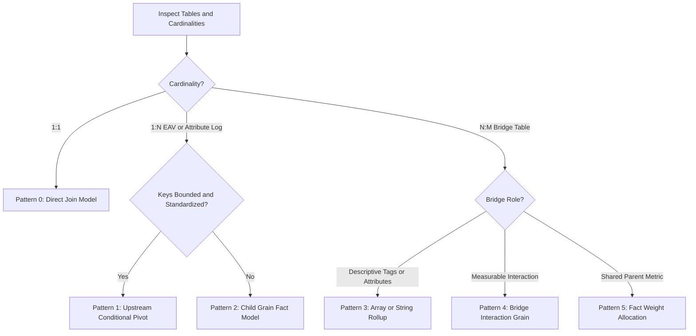

# Grain governance for multi-cardinality joins (datus-semantic-osi + OKF)

Status: accepted (owner, 2026-09-15). Imported from selayer's ADR-0042 and adapted to ariadne; independently confirmed by our fan-out trap finding (run mvp-4: `datus-semantic-osi` 0.1.7 aggregates at joined-row grain — upstream issue [Datus-ai/Datus-agent#1426](https://github.com/Datus-ai/Datus-agent/issues/1426)).

**Decision:** the engine never arbitrates multi-grain joins, so grain alignment is enforced upstream during dataset construction and strictly constrained at metric-definition time. In ariadne: the facade guard (`_check_grain_preserving`) rejects non-grain-preserving ad-hoc sources before compile; the audit protocol in §5 belongs to `ariadne/validate.py` using profiler uniqueness evidence; the rubric in §3 guides the authoring agent and the guard's rejection guidance.

Related: ADR-0005 (no-unvalidated-execution invariant) · spec §13 (trap, guard, sentinel) · CONTEXT.md (Fan-out term).

The normative rubric, OKF metadata contract, audit protocol, and implementation contract follow — body preserved from the source ADR, section numbering kept for cross-project reference.

---

## 1. Context & Architectural Constraints

### 1.1 The Engine Limitation (Apache Ossie / `datus-semantic-osi`)

The semantic execution engine exhibits the following architectural behaviors:

1. **Joined-Row Execution Grain:** All declared metric expressions (aggregations) compile directly over the flattened, post-join tabular result set.
2. **Absence of Symmetric Aggregates:** The engine lacks automated fan-out protection (e.g., primary-key hashing, automatic subquery pushdown, or Looker-style symmetric aggregation).
3. **No Cross-Semantic-Model Federation:** Attempts to isolate tables across independent semantic models and query across them are rejected at runtime with:
   > *"Cross-semantic-model queries are not supported."*

### 1.2 The Failure Mode (Silent Aggregate Inflation)

When an agent defines a semantic model comprising non-isomorphic cardinalities (1:N or N:M), metric calculations belonging to the upper ("one" or "parent") grain are silently multiplied by the fan-out factor of the lower ("many") side. This results in corrupt metrics without throwing query or validation errors.

---

## 2. Decision & Core Principles

To guarantee deterministic, mathematically sound analytics, the Semantic Modeling and Audit Agents **MUST NOT** rely on the semantic engine to arbitrate multi-grain joins.

Grain alignment and fan-out prevention **must be enforced upstream during dataset construction** or **strictly constrained at metric definition time**.

### Golden Rules for Model Generation Agents

1. **Rule of Single Declared Grain:** Every Ossie Semantic Model must map to exactly one declared semantic grain.
2. **Rule of Additive Metric Ownership:** An additive measure (`SUM`, `AVG`, `STDDEV`) may **only** be declared for fields that originate natively at the model's declared grain.
3. **Rule of Cardinality Elimination:** 1:N (attribute logs) and N:M (junctions) must be resolved into 1:1 or single-grain representations prior to semantic layer registration.

---

## 3. Normative Resolution Patterns (Agent Decision Rubric)

Autonomous agents must classify target source relations into one of three structural archetypes and apply the corresponding architectural pattern.



---

### Pattern 1: Upstream Conditional Pivot (1:N Attribute / EAV Logs)

* **Trigger:** A parent entity (1) joins to a child table (N) where the child records represent discrete, repeated tests, parameters, or attribute keys (e.g., EAV structures, standardized test runs, order line status milestones).
* **Condition:** The attribute key domain is bounded, known, and standardized.
* **Agent Directive:**
  1. Construct an upstream view (dbt/SQL) that pivots child records into dedicated columns using conditional aggregation grouped by the parent entity primary key.
  2. Enforce deterministic qualification for re-runs/duplicates (e.g., `ROW_NUMBER() OVER (PARTITION BY entity_id, key ORDER BY timestamp DESC) = 1`).
  3. Join the parent entity table to the pivoted view (1:1 cardinality).
  4. Register the model at the **Parent Entity Grain**.

#### Examples

##### Typical E-Commerce / Orders Domain

* **Source:** `Orders` (1) -> `Order_Milestones` (N events: `PLACED`, `PAYMENT_CLEARED`, `SHIPPED`, `DELIVERED`).
* **Pivoted Columns:** `placed_at`, `payment_cleared_at`, `shipped_at`, `delivered_at`.
* **Grain:** 1 row per `order_id`.

##### Shopfloor / Manufacturing Domain

* **Source:** `Motor_Production` (1) -> `EoL_Tests` (N tests: `TORQUE`, `RELEASE_TIME`, `LEAKAGE`).
* **Pivoted Columns:** `holding_torque_nm`, `release_time_ms`, `leakage_ma`.
* **Grain:** 1 row per `motor_id`.

---

### Pattern 2: Child Grain Fact Model (1:N Unbounded / Dynamic Logs)

* **Trigger:** A parent entity (1) joins to a child table (N) where the child keys are unbounded, heterogeneous, or dynamic time-series.
* **Condition:** Pivoting into fixed columns is structurally unviable.
* **Agent Directive:**
  1. Define the semantic model strictly at the **Child Grain**.
  2. Denormalize parent attributes down into the child view strictly as **Dimensions** (categories/filters).
  3. **Strict Ban:** Do not register any parent-level additive measures (`SUM`).
  4. Parent entity counting must strictly use `COUNT(DISTINCT parent_id)`.

#### Examples

##### Typical E-Commerce / Orders Domain

* **Model Grain:** 1 row per `order_item_id`.
* **Allowed Measures:** `SUM(line_item_amount)`, `AVG(unit_discount)`, `COUNT(DISTINCT order_id)`.
* **Forbidden Measure:** `SUM(order_shipping_fee)` *(would multiply shipping fees by total items in order)*.

##### Shopfloor / Manufacturing Domain

* **Model Grain:** 1 row per `test_execution_id`.
* **Allowed Measures:** `AVG(measurement_value)`, `COUNT(*)`, `COUNT(DISTINCT motor_id)`.
* **Forbidden Measure:** `SUM(motor_unit_cost)`.

---

### Pattern 3: Array / Set Rollup (N:M Descriptive Bridge)

* **Trigger:** Two entities (A and B) relate via an associative table (N:M), where Entity B provides labels, categories, error codes, tags, or certifications for Entity A.
* **Agent Directive:**
  1. Do not join the bridge directly inside the Ossie dataset.
  2. In an upstream SQL view, group the bridge table by Entity A's primary key and roll Entity B attributes into a native `ARRAY` or delimited string (`STRING_AGG`).
  3. Register the model at Entity A's grain.
  4. Use array-containment functions for downstream semantic filtering.

#### Examples

##### Typical E-Commerce / Orders Domain

* **Entities:** `Products` (N) <-> `Product_Tags` <-> `Tags` (M).
* **Rollup:** `SELECT product_id, ARRAY_AGG(tag_name) AS tags FROM ... GROUP BY product_id`.
* **Grain:** 1 row per `product_id`. `SUM(inventory_value)` remains uncorrupted.

##### Shopfloor / Manufacturing Domain

* **Entities:** `Motors` (N) <-> `Motor_Operators` <-> `Operators` (M).
* **Rollup:** `SELECT motor_id, STRING_AGG(operator_id, ', ') AS operator_ids FROM ... GROUP BY motor_id`.
* **Grain:** 1 row per `motor_id`. `SUM(production_cost)` remains uncorrupted.

---

### Pattern 4: Bridge Interaction Grain (N:M Relationship Analytics)

* **Trigger:** The relationship between Entity A and Entity B represents an event or state possessing its own lifecycle metrics (e.g., cross-assignments, multi-party sessions).
* **Agent Directive:**
  1. Establish the model grain as the **Bridge Table Primary Key** (`pair_id` or `(a_id, b_id)`).
  2. Dimensions from both Entity A and Entity B are projected down as dimensional attributes.
  3. Metrics defined over Entity A or Entity B must strictly be `COUNT(DISTINCT)`.
  4. Additive metrics (`SUM`) are only permitted on numeric attributes belonging natively to the interaction itself.

#### Examples

##### Typical E-Commerce / Orders Domain

* **Entities:** `Campaigns` (N) <-> `Campaign_Customer_Bridge` <-> `Customers` (M).
* **Grain:** 1 row per `(campaign_id, customer_id)`.
* **Allowed Measures:** `COUNT(*)` (Engagements), `COUNT(DISTINCT customer_id)`, `SUM(interaction_duration_seconds)`.
* **Forbidden Measures:** `SUM(customer_lifetime_value)`, `SUM(campaign_total_budget)`.

##### Shopfloor / Manufacturing Domain

* **Entities:** `Motors` (N) <-> `Assembly_Bridge` <-> `Workstations` (M).
* **Grain:** 1 row per `(motor_id, workstation_id)`.
* **Allowed Measures:** `SUM(station_dwell_time_seconds)`, `COUNT(DISTINCT motor_id)`.

---

### Pattern 5: Fact Weight Allocation (N:M Metric Splitting)

* **Trigger:** An additive metric originating from an upper parent entity must be distributed across an N:M or 1:N relationship without inflating the total sum.
* **Agent Directive:**
  1. Upstream, calculate an analytic allocation coefficient:
     `weight = 1.0 / COUNT(*) OVER (PARTITION BY parent_id)`
  2. Compute an allocated metric column:
     `allocated_val = raw_metric_val * weight`
  3. Register `SUM(allocated_val)` as the certified metric in the semantic layer.

#### Examples

##### Typical E-Commerce / Orders Domain

* Splitting an order-level `shipping_cost` across individual order line items based on item value or equal fractional weight:
  `line_shipping_share = order_shipping_cost * (line_price / order_total)`

##### Shopfloor / Manufacturing Domain

* Splitting a supplier batch testing fee across all motors assembled from that batch:
  `allocated_batch_cost = batch_testing_fee * (1.0 / motors_per_batch_count)`

---

## 4. OKF Spec v0.2 Context Layer Integration

When the Context Layer Agent parses or produces schemas according to OKF Spec v0.2, it must populate context metadata with grain declarations and validation assertions.

### 4.1 Schema Metadata Extension (OKF Schema Decorator)

Every dataset node generated for `apache-ossie` consumption must declare its exact grain and verified cardinality mappings:

```yaml
schema_version: "okf-spec-v0.2"
id: "urn:dataset:production:motor_eol_flattened"
name: "motor_eol_flattened"
description: "Pivoted 1:1 view uniting motor assembly metadata with final test readings."

grain:
  primary_key: ["motor_id"]
  cardinality_enforcement: "STRICT_1_TO_1"

cardinality_audit:
  upstream_pattern: "PATTERN_1_CONDITIONAL_PIVOT"
  source_tables:
    - table: "raw.motor_production"
      role: "PARENT"
      cardinality: "1"
    - table: "raw.eol_tests"
      role: "CHILD_LOG"
      cardinality: "N"
      resolution: "PIVOT_ON_TEST_TYPE"

dimensions:
  - name: "motor_id"
    type: "string"
    is_primary_key: true
  - name: "brake_type"
    type: "string"
  - name: "brake_supplier_batch_id"
    type: "string"

measures:
  - name: "total_motors"
    expression: "COUNT(motor_id)"
    type: "additive"
  - name: "avg_holding_torque"
    expression: "AVG(holding_torque_nm)"
    type: "additive"
    grain_safe: true
```

---

## 5. Autonomous Audit Agent: Pre-Flight Verification Protocol

*Ariadne mapping: the Audit Agent role is `ariadne/validate.py` at the pre-flight compile step — Assertion 1 reuses the profiler's unique-ratio evidence; Assertion 2 runs on the read-only DuckDB attach.*

Before writing an Ossie configuration, the Audit Agent must execute the following automated validation protocol against the physical warehouse:

### Assertion 1: Uniqueness Test (Grain Verification)

Verify that the proposed dataset grain is strictly distinct:

```sql
SELECT 
    COUNT(*) AS total_rows,
    COUNT(DISTINCT {declared_primary_key}) AS distinct_keys
FROM {candidate_dataset_or_view};
```

* **Failure Condition:** `total_rows != distinct_keys`.  
* **Remediation:** Halt generation. Trigger Pattern 1 (Pivot) or Pattern 2 (Child Grain Fallback).

### Assertion 2: Parent Aggregate Invariance Test

Ensure that metrics from the parent side have not undergone fan-out inflation:

```sql
WITH baseline AS (
    SELECT SUM({parent_metric}) AS original_sum FROM {raw_parent_table}
),
modeled AS (
    SELECT SUM({parent_metric}) AS post_join_sum FROM {candidate_dataset_or_view}
)
SELECT 
    b.original_sum, 
    m.post_join_sum,
    (m.post_join_sum - b.original_sum) AS divergence
FROM baseline b, modeled m;
```

* **Failure Condition:** `divergence != 0`.  
* **Remediation:** Remove `{parent_metric}` from model measures or apply Pattern 5 (Weight Allocation).

---

## 6. Summary: Agent Implementation Contract

| Step | Agent Responsibility | Output Artifact |
| :--- | :--- | :--- |
| **1. Inspection** | Inspect primary keys, foreign keys, and cardinalities across tables. | Cardinality Graph |
| **2. Pattern Selection** | Apply the Decision Rubric to select Pattern 1, 2, 3, 4, or 5. | Architecture Decision Log |
| **3. Upstream DDL** | Emit dbt model / SQL view containing pivots, rollups, or allocations. | Transformed View SQL |
| **4. Pre-Flight Audit** | Execute Assertions 1 & 2 against target data. | Verification Result (Pass/Fail) |
| **5. Ossie Config** | Emit OSI YAML/JSON declaring measures strictly aligned with target grain. | `ossie_model.yaml` |
| **6. OKF Decoration** | Document semantic grain, cardinality resolution, and metadata. | `okf_context_v02.json/yaml` |

*Ariadne mapping: Inspection → `ariadne/profiler.py` · Pattern Selection → authoring-agent prompt + `define_metric` rejection guidance · Upstream DDL → agent-authored `source` SQL (ad-hoc path) or staged authoring output · Pre-Flight Audit → `ariadne/validate.py` · Ossie Config → `semantic_layer/` · OKF Decoration → `context_layer/` pages.*
