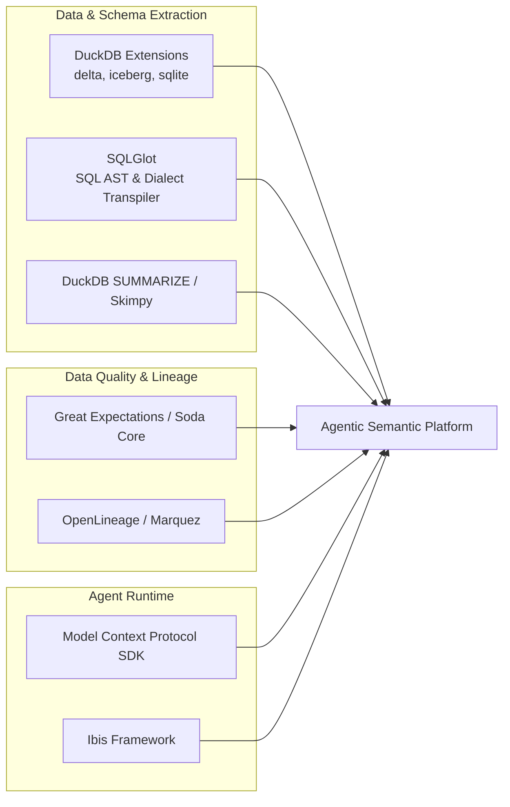

# Design Study: 3-Tier Agentic Data Intelligence

### *Ontology, Context Layer (OKF v0.2), Semantic Layer (Apache Ossie / DOSI), and Unified Execution*

| | |
| :--- | :--- |
| **Type** | Research — design study (evidence per `docs/agents/artifacts.md`) |
| **Status** | Proposed — owner-reviewed brainstorming findings |
| **Date** | 2026-09-14 |
| **Question** | How should autonomous AI agents query heterogeneous storage (Delta Lake, Iceberg, DuckDB, SQLite) with governed metrics — beyond raw text-to-SQL? |
| **Contract** | planning-contract v1; skill provenance: `legout/skills` via `npx skills` (per-skill hashes in `skills-lock.json`; catalog revision unknown) |

> **Approval boundary:** This note is evidence, even where the owner accepts its findings. Acceptance is not authorization to build. Behavioral contracts with acceptance criteria belong in `docs/specs/` (shaped by `shape-design`); consequential approved choices belong in `docs/adr/`. No specification or ADR currently owns or links this study.

> **Engine correction (2026-09-16):** the implemented compile engine is **`datus-semantic-osi` 0.1.7 (Apache-2.0)** plus its vendored **`datus-metricflow` 0.2.8 (AGPL-3.0, transitive runtime dependency)** — **not** the "DOSI Engine". The proprietary `dosi-engine` (Elastic-2.0, binaries-only via `datus-ai/dosi-dist`) was evaluated in the spike and **not adopted** ([datus-spike.md §6.8](datus-spike.md)). All "DOSI (Engine)" mentions below are deprecated shorthand for the `datus-semantic-osi` compile path; read them as such.

---

## 1. Executive Summary & Core Paradigm

Querying diverse, multi-engine data environments (**Delta Lake, Apache Iceberg, DuckDB, SQLite**) with autonomous AI agents requires moving beyond raw text-to-SQL.

Direct text-to-SQL fails in enterprise settings because it conflates three fundamentally different responsibilities:

1. **Understanding what real-world entities exist** (*Ontology*).
2. **Understanding business rules, routing, and operational caveats** (*Context Layer*).
3. **Calculating governed, fan-out-safe metrics deterministically** (*Semantic Layer*).

> **Core Axiom:** *The Context Layer routes and guides; the Semantic Layer calculates and executes.*

---

## 2. The 3-Tier Architecture (MotherDuck Model)

```mermaid
flowchart TD
    subgraph Tier1["1. Ontology Layer (The World Model)"]
        O[Business Entities & Conceptual Graph<br>Customer, Order, Product, Facility, Contract]
    end

    subgraph Tier2["2. Context Layer (Business Nuance & Guidance)"]
        OKF[Open Knowledge Format: OKF v0.2<br>• Tribal knowledge & operational quirks<br>• Business rules & filtering requirements<br>• Routing instructions to semantic models<br>• Provenance & trust tiers]
    end

    subgraph Tier3["3. Semantic Layer (Governed Calculation Engine)"]
        OSI[Apache Ossie: OSI YAML Models<br>• Dimensions & Measures<br>• Join paths & attribution logic]
        DOSI[DOSI Engine: Rust SQL Compiler<br>• "Fan-out protection" — disproven, see note<br>• Dialect compilation & MCP server<br>(deprecated name — engine is datus-semantic-osi)]
    end

    subgraph Tier4["4. Execution & Storage Layer"]
        DuckDB[DuckDB Unified Engine<br>sqlite_scanner, delta, iceberg extensions]
        DuckDB --> S1[(Delta Lake)]
        DuckDB --> S2[(Apache Iceberg)]
        DuckDB --> S3[(DuckDB / SQLite DBs)]
    end

    Agent[AI Agent] -->|1. Resolves business entities| O
    Agent -->|2. Reads routing rules & gotchas| OKF
    Agent -->|3. Requests governed metrics via MCP| DOSI
    OSI --> DOSI
    DOSI -->|4. Emits optimized dialect SQL| DuckDB
```

> **Correction (spec rev 5 trap proof):** DOSI does **not** protect against fan-out — a scratch
> orders⋈lines one-to-many model compiled through the governed path returned the inflated
> joined-row total (NA 700 vs the correct deduplicated 300; 1100 vs 700 overall). Upstream:
> [Datus-ai/Datus-agent#1426](https://github.com/Datus-ai/Datus-agent/issues/1426). Ariadne
> enforces grain preservation on agent-authored sources at its own facade instead (spec rev 5
> §13 disposition: facade grain guard + strict-xfail sentinel).

| Layer | Responsibility | Format / Standard | Role in Agentic Workflow |
| :--- | :--- | :--- | :--- |
| **1. Ontology** | *The World Model* | Entity definitions & relations (YAML / OKF Entities) | Establishes the conceptual entities (e.g., `Customer`, `Order`, `Asset`) and how they link across distinct databases. |
| **2. Context Layer** | *The Business Guide* | **[OKF v0.2](https://github.com/GoogleCloudPlatform/open-knowledge-format)** (Markdown + YAML Frontmatter) | Ingests tribal knowledge, caveats, filter conditions, and routes questions to the appropriate semantic models. |
| **3. Semantic Layer** | *The Calculation Engine* | **[Apache Ossie](https://github.com/open-semantic-interchange/OSI)** + ~~**[DOSI Engine](https://dosi.datus.ai)**~~ → **`datus-semantic-osi`** *(corrected 2026-09-16)* | Compiles deterministic, multi-dialect SQL; does not prevent fan-out (correction above) — grain safety is enforced at the Ariadne facade. |
| **4. Storage & Execution** | *The Unified Hub* | **DuckDB** + Native Lakehouse Extensions | Mounts Delta, Iceberg, DuckDB, and SQLite into a single in-process SQL execution engine. |

---

## 3. Specification & Tool Index

* **[Open Knowledge Format (OKF v0.2)](https://github.com/GoogleCloudPlatform/open-knowledge-format)**: Open specification by Google Cloud for storing context, trust tiers, lifecycle states, and domain caveats in version-controlled Markdown.
* **[Apache Ossie / OSI Specification](https://github.com/open-semantic-interchange/OSI)**: Vendor-neutral, declarative YAML specification for defining datasets, metrics, dimensions, and joins.
* **[DOSI Engine (Datus)](https://dosi.datus.ai)** *(deprecated term — evaluated in the spike, **not adopted**; proprietary, Elastic-2.0)*: Rust-based compiler and Model Context Protocol (MCP) server that transforms Apache Ossie models into optimized dialect SQL (DuckDB, Snowflake, BigQuery, Postgres). The implemented engine is `datus-semantic-osi` (Apache-2.0) + vendored `datus-metricflow` (AGPL-3.0, transitive runtime — see engine correction above).
* **[Wren AI / Wren MDL](https://github.com/Canner/Wren-Engine)**: AI-native semantic modeling engine designed for LLM text-to-SQL workflows.
* **[Malloy Language](https://www.malloydata.dev/)**: Embedded semantic data modeling DSL from the original Looker team, with native DuckDB integration.
* **[Cube](https://cube.dev)**: Mature headless semantic layer (YAML/JS cubes) — primary fallback for the semantic layer (see §9).
* **[dbt MetricFlow](https://docs.getdbt.com/docs/build/semantic-models)**: dbt-native semantic layer — fallback #2 (see §9).
* **[nao](https://github.com/getnao/nao)**: Open-source analytics agent (dbt + nao-core context CLI) — complementary category, not a semantic-layer alternative (see §9).
* **[MotherDuck Blog: Context Layer vs. Semantic Layer vs. Ontology](https://motherduck.com/blog/context-layer-vs-semantic-layer-ontology/)**: Conceptual blueprint for separating business reasoning from deterministic calculation.

---

## 4. End-to-End Autonomous Authoring Pipeline

An authoring agent builds both the **Context Layer (OKF)** and the **Semantic Layer (OSI)** automatically using statistical profiling and unstructured documentation:

```mermaid
flowchart TD
    subgraph Inputs
        RawData[(Delta, Iceberg, DuckDB, SQLite)]
        Docs[Data Dictionaries, Confluence Dumps, SQL Views]
    end

    subgraph 1. Profiling
        P1[DuckDB Profiler<br>• SUMMARIZE column metrics<br>• Candidate primary/foreign key detection<br>• Distinct value & distribution checks]
    end

    subgraph 2. Agent Synthesis
        A1[Authoring Agent<br>• Match tables to ontological entities<br>• Draft OSI measures & join graphs<br>• Extract business rules & gotchas into OKF]
    end

    subgraph 3. Artifact Generation
        O1[OSI Models .yml<br>Datasets, Dimensions, Measures]
        O2[OKF v0.2 Files .md<br>Frontmatter metadata & domain nuances]
    end

    subgraph 4. Deterministic Validation
        V1[DOSI Pre-flight Compilation Check<br>(deprecated — datus-semantic-osi compile + grain audit)]
        V2[DuckDB Test Metric Execution]
    end

    RawData --> P1
    Docs --> A1
    P1 --> A1
    A1 --> O1 & O2
    O1 --> V1
    V1 --> V2
    V2 -->|Errors / Circular Joins| A1
```

---

## 5. Concrete Artifact Examples

### A. Context Layer: `okf/metrics/gross_margin.md` (OKF v0.2)

```markdown
---
type: metric_context
status: stable
verified: true
sources:
  - s3://lakehouse/iceberg/orders
  - db/sqlite/legacy_adjustments.db
  - docs/accounting_handbook_2026.pdf
generated: 2026-09-11
stale_after: 2027-01-01
---

# Gross Margin

### Business Definition & Scope
Gross Margin represents total billed revenue less direct cost of goods sold (COGS). Excludes tax, shipping surcharges, and customer return allowances.

### Operational Gotchas & Filtering Rules
- **Order Status:** Records where `status IN ('CANCELLED', 'RETURNED')` must be excluded.
- **Regional Quirks:** EMEA orders in the legacy SQLite database before 2024 were stored in local currencies without conversion; ensure `currency_conversion_rate` is joined.
- **Routing:** Direct all general gross margin queries to the governed OSI measure `orders.gross_margin`.
```

### B. Semantic Layer: `osi/models/orders.yml` (Apache Ossie)

```yaml
name: orders
source: iceberg_catalog.finance.orders
primary_key: order_id

dimensions:
  - name: order_date
    type: date
    sql: order_timestamp::DATE
  - name: status
    type: string
    sql: status
  - name: region
    type: string
    sql: region_code

measures:
  - name: gross_revenue
    type: sum
    sql: amount
    filters:
      - sql: status NOT IN ('CANCELLED', 'RETURNED')

  - name: cogs
    type: sum
    sql: product_cost

  - name: gross_margin
    type: number
    sql: (gross_revenue - cogs) / NULLIF(gross_revenue, 0)

joins:
  - name: customers
    to: customers
    type: many_to_one
    on: customer_id = customers.id
```

### C. Ontology Layer: `context_layer/ontology/order.md` (OKF Entity)

```markdown
---
type: entity
status: stable
verified: true
sources:
  - iceberg_catalog.finance.orders
  - db/sqlite/legacy_orders.db
generated: 2026-09-11
stale_after: 2027-01-01
---

# Order

### Definition
A single billed transaction header. One Order has many Order Lines and belongs to exactly one Customer.

### Identity & Keys
- Primary key: `order_id` (Iceberg `finance.orders`)
- Legacy equivalent: pre-2024 orders in SQLite, mapped via `legacy_id_map`

### Relationships
- `many_to_one` → [[Customer]] via `customer_id`
- `one_to_many` → Order Lines via `order_id`

### Semantic Binding
All governed measures for this entity live in the OSI model `osi/models/orders.yml`.
```

---

## 6. Recommended Supporting Libraries & Ecosystem



1. **Introspection & Schema Extraction:**
   * **DuckDB Extensions (`delta`, `iceberg`, `sqlite_scanner`):** Unifies all heterogeneous files and databases under a single catalog.
   * **`sqlglot`:** Analyzes legacy SQL views, extracts dependencies, and transpiles expressions across dialects.
   * **`duckdb.sql("SUMMARIZE table")`:** Generates low-token, high-density statistical profiles for LLM consumption.
2. **Data Contracts & Lineage:**
   * **Great Expectations / Soda Core:** Allows the agent to compile automated data validation suites from OKF rules.
   * **OpenLineage:** Supplies automated lineage graphs to populate OKF `sources` frontmatter.
3. **Agent Integration & Abstraction:**
   * **Model Context Protocol (MCP) SDK:** Connects DOSI's metric execution and the OKF knowledge base directly into agent runtimes.
   * **Ibis (`ibis-framework`):** Provides a Python dataframe expression layer for programmatic metric testing against DuckDB and SQLite.

---

## 7. Operational Repository Structure

```text
├── agent/
│   ├── profiler.py              # DuckDB SUMMARIZE & FK heuristic runner
│   ├── doc_parser.py            # RAG over data dictionaries & PDF specs
│   ├── osi_generator.py         # Emits Apache Ossie YAML models
│   ├── okf_generator.py         # Emits OKF v0.2 Markdown files
│   └── validator.py             # Pre-flight DOSI compiler & query runner
│
├── context_layer/               # OKF v0.2 Knowledge Base
│   ├── ontology/                # Business entity definitions (Customer, Order)
│   ├── datasets/                # Table caveats, filtering rules, and provenance
│   └── metrics/                 # Business definitions & calculation nuances
│
└── semantic_layer/              # Apache Ossie (OSI) Repository
    ├── datasets/                # Physical source bindings (DuckDB/Iceberg/Delta)
    ├── models/                  # Dimensions, logical tables & joins
    └── metrics/                 # Governed measures & rollups for DOSI execution
```

**Deployment topology:** DuckDB is in-process and single-writer. One MCP server process owns the DuckDB connection; agents profile through it read-only; generated artifacts flow through git, not the database. If concurrent writes ever become necessary, the MCP server stays the single writer — do not add application-level locking.

---

## 8. Managing Drift and Staleness

* **Lifecycle Tracking:** When an agent encounters an OKF file where `today() > stale_after`, it marks the context as `status: review_needed` and notifies the maintainers.
* **Automated Drift Detection:** Scheduled CI runs re-execute DuckDB profiling across Iceberg/Delta tables. If new columns appear or null percentages spike, the agent updates the corresponding OKF/OSI files and sets `verified: machine-confirmed` pending human review.
* **Human Review Gate:** Agent-generated OKF/OSI changes land as pull requests against this repository. Human merge is what sets `verified: true`; `machine-confirmed` artifacts never reach the agent-served branch unreviewed.

---

## 9. Alternatives Considered (Why Not)

Effort scale: **S** = days, **M** = 1–2 weeks, **L** = month+ (one engineer, one-way OSI → tool emitter).

| Tool | Why not | Interop effort |
| :--- | :--- | :--- |
| **Cube** | Strongest fallback. Mature and production-proven, but it is a serving layer to *operate* (API gateway, caching, refresh workers) — more infrastructure than the MVP needs, and its model format is vendor-specific rather than the neutral interchange spec. | **S.** YAML→YAML, near 1:1: model→cube, joins, measures. |
| **dbt MetricFlow** | Mature and open source, but adopting it pulls in the dbt project/workflow — heavy if you are not already a dbt shop. Fallback #2. | **S–M.** dataset→semantic model; `gross_margin`-style ratios map to MetricFlow `ratio` metrics; entity/join semantics need care. |
| **Wren MDL** | Overlaps DOSI's role but is a second startup's spec instead of an Apache-incubating one; weaker governance and fan-out story. | **M.** Wren projects are YAML ([models, relationships, cubes](https://docs.getwren.ai/oss/reference/mdl)) — mechanical, but semantics differ. |
| **Malloy** | A language, not a config format: no governed-metric registry concept, and it requires adopting a compiler/VS Code toolchain. Native DuckDB support noted for ad-hoc work. | **M export / L import.** Generating Malloy sources is feasible; importing *from* Malloy requires its TypeScript parser and is lossy for nested views. |
| **nao** | An analytics *agent* ([open source](https://github.com/getnao/nao), dbt + nao-core context CLI), not a semantic-layer spec — a complementary category, not an alternative. Could sit on top of this stack. | **N/A.** No model format to compile to; interop would run through dbt models. |

## 10. Import/Export Strategy

* **One-way emitters only, never bidirectional sync.** OSI is the source of truth; target formats are disposable projections. Bidirectional sync requires identity mapping and round-trip fidelity, which multiplies effort 3–5× and is almost never worth it.
* **OSI is designed to be this hub.** dbt Labs is a founding OSI member [alongside Snowflake and Salesforce](https://www.businesswire.com/news/home/20250923902448/en/Snowflake-Salesforce-dbt-Labs-and-More-Revolutionize-Data-Readiness-for-AI-with-Open-Semantic-Interchange-Initiative) ([working group roster](https://ossie.apache.org/ecosystem/)), so native OSI import in MetricFlow-class tools is plausible within the spec's lifetime — adapters written today may become obsolete.
* **YAGNI for MVP:** build zero adapters now. If DOSI disappoints, write the Cube emitter first (S effort, mature target).

## 11. Dependency Risk & Version Pins

This stack pins three young specifications. Record exact versions in this repository and upgrade deliberately:

* **OKF** — pinned at **v0.2**.
* **Apache Ossie (OSI)** — incubating; pin to a spec commit/tag.
* ~~**DOSI Engine** — pin to a released version; startup product~~ *(corrected 2026-09-16)*: actual pins live in `pyproject.toml` — `datus-semantic-osi==0.1.7` (Apache-2.0) with transitive `datus-metricflow 0.2.8` (**AGPL-3.0**; flagged for any public-distribution decision).

Escape hatches per layer: **context layer** → plain Markdown + YAML frontmatter (OKF is a superset; migration is mechanical). **Semantic layer** → Cube or MetricFlow (see §9). **Execution layer** → DuckDB regardless. Rule: layers couple through the file artifacts they produce, never through tool-specific APIs.

## 12. MVP Scope — Explicitly Deferred

Deliberately out of scope for the MVP/PoC to protect pace — both are mandatory before production:

* **Access control & governance** (authZ, row/column security, PII masking, audit): deferred — single-user PoC on trusted data. **Revisit before any multi-user access or production data.**
* **Semantic-correctness evaluation** (golden question→metric test sets, fan-out/chasm-trap proofs): deferred — compilation and execution checks only for MVP. **Revisit before agents author models unsupervised.**

---

## Appendix: Primary Sources

Each load-bearing claim above was followed back to the source that owns it:

* **OKF v0.2 spec & trust signals:** [google/open-knowledge-format](https://github.com/GoogleCloudPlatform/open-knowledge-format) (`SPEC.md`); [OKF v0.2 announcement](https://cloud.google.com/blog/products/data-analytics/okf-v0-2-adds-trust-signals)
* **Apache Ossie (incubating) / OSI spec:** [ossie.apache.org](https://ossie.apache.org/); [open-semantic-interchange/OSI](https://github.com/open-semantic-interchange/OSI)
* **OSI founding coalition:** [BusinessWire launch release](https://www.businesswire.com/news/home/20250923902448/en/Snowflake-Salesforce-dbt-Labs-and-More-Revolutionize-Data-Readiness-for-AI-with-Open-Semantic-Interchange-Initiative); [ecosystem roster](https://ossie.apache.org/ecosystem/)
* **DOSI engine:** [Datus.ai DOSI docs](https://dosi.datus.ai)
* **Cube:** [cube.dev](https://cube.dev) (data modeling docs)
* **dbt MetricFlow:** [Semantic models](https://docs.getdbt.com/docs/build/semantic-models)
* **Wren MDL:** [Wren project YAML reference](https://docs.getwren.ai/oss/reference/mdl)
* **Malloy:** [malloydata.dev](https://www.malloydata.dev/)
* **nao:** [getnao/nao](https://github.com/getnao/nao)
* **DuckDB extensions:** [duckdb.org docs](https://duckdb.org/docs/stable/extensions/overview) (`delta`, `iceberg`, `sqlite_scanner`)
* **Layer-separation framing:** [MotherDuck: Context Layer vs. Semantic Layer vs. Ontology](https://motherduck.com/blog/context-layer-vs-semantic-layer-ontology/)
