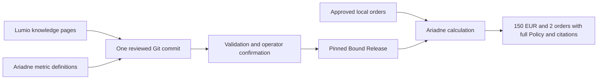

# Lumio + Ariadne locally: knowledge, a governed answer, and an update

Use this tutorial to see both tools working together with three supplied,
synthetic retail orders. You will get **150 EUR recognized revenue and two
completed orders**, with the complete governing Policy and citations. Then you
will change the knowledge and see why a Git commit alone does not activate it.

**Lumio** maintains readable knowledge and its identity. **Ariadne** validates
and executes the metric definitions, binds them to that knowledge, and serves
the operator-confirmed version. You explicitly approve the example source and
confirm the overall release. The helper prints those human commands; it never
executes them for you.



This route needs Python **3.14+**, Git, [uv](https://docs.astral.sh/uv/), and a
POSIX shell. It uses published `ariadne-data==0.6.0` and `lumio-wiki==0.4.0`.
This tested baseline requires DuckDB 1.x; the explicit constraint below
excludes the incompatible DuckDB 2.0 relation API.
No Docker, object store, LanceDB, server, model or API key is required. Allow
about 15–20 minutes for the first pass. Downloads require internet access;
the example itself runs locally.

## 1. Install the tools and obtain the example

Clone the software repository for the example files, then install the released
packages into a virtual environment. The software checkout and your example
**data project** will be separate directories:

```bash
git clone https://github.com/legout/ariadne.git ariadne-tools
# This repository is approved to be renamed legout/ariadne-lumio; the current
# URL keeps working through that pending rename.
cd ariadne-tools
uv venv --python 3.14 .venv
uv pip install --python .venv/bin/python \
  'ariadne-data==0.6.0' 'lumio-wiki==0.4.0' 'duckdb>=1.0,<2'
. .venv/bin/activate
export EXAMPLE="$PWD/examples/local-lumio-ariadne"
export DEMO="$HOME/ariadne-retail-demo"
python "$EXAMPLE/demo.py" create "$DEMO"
```

Choose another `DEMO` path if that directory already exists. Creation refuses
existing directories. It copies the supplied files, builds one local DuckDB
catalog from the synthetic CSV, initializes Git and sets a tutorial identity
**only in that new repository**. It does not approve or admit anything.

The authored input is deliberately small:

| Order | EUR amount | Status | Recognized? |
| --- | ---: | --- | --- |
| 1 | 100 | completed | yes |
| 2 | 50 | completed | yes |
| 3 | 25 | cancelled | no |

The expected result is hand-worked: `100 + 50 = 150`; two orders count. The
example has no returns or taxes. No meaning is inferred from observed values.

## 2. Explore the knowledge with Lumio

```bash
lumio-wiki --version
lumio-wiki validate "$DEMO/knowledge"
lumio-wiki search "$DEMO/knowledge" "recognized"
lumio-wiki page "$DEMO/knowledge" "Cancelled Orders"
```

Search should find the recognized-revenue definition, its governing Policy
and the glossary. The Policy excludes cancelled orders and states the unit.
These commands inspect the mutable authoring tree; they do not activate a
release for Ariadne.

The project has these main parts:

```text
ariadne-retail-demo/
├── data/orders.csv                    # the three synthetic input rows
├── data/orders.duckdb                 # generated local source; ignored by Git
├── data/seed_notes.md                 # authored business assumptions
├── semantic_layer/models/retail_sales.yml  # executable metric definitions
├── semantic_layer/graph.yml           # the native multi-metric graph
├── context_layer/metrics/             # required Core catalog entries
├── context_layer/policies/            # a technical citation pointer
├── knowledge/                        # one maintained source of curated knowledge
│   ├── lumio.yaml                    # categories and ontology
│   ├── .lumio-authoring.yaml          # stable KB namespace
│   ├── metrics/                      # Metric profiles bound to the OSI definitions
│   ├── policies/cancelled-orders.md   # complete governing business rule
│   └── references/                   # ordinary explanatory glossary
└── context_integration.yaml          # selects this integrated route
```

The small Core catalog entries satisfy native validation and point to the
curated knowledge; they are not second editable copies of its rule. Git carries
the authored definitions and knowledge. Local database files, approvals and
active admissions do not become shared Git permissions.

## 3. Propose the source; approve it yourself

```bash
python "$EXAMPLE/demo.py" propose "$DEMO"
```

The helper starts a native Git proposal, proposes the single DuckDB source,
and prints its resolved identity plus an exact `ariadne-authoring
approve-sources` command. Check that it names only your new example database,
then **run that printed command yourself** if you approve it. Your proposal ID,
revision and digest will differ from anyone else's; do not copy invented ones.

This permission allows the native workflow to inspect that exact source. It
does not approve the metric definitions or activate the knowledge.

## 4. Validate, inspect the review, and confirm the combined release

```bash
python "$EXAMPLE/demo.py" review "$DEMO"
```

This runs the existing validation, reads the native review and previews the
overall admission. Inspect its source, definitions, Policy, visibility (`public`)
and local publication destination. Generated Core bookkeeping may create a final
commit; the helper uses the **validation-returned** revision rather than the
input revision.

The helper prints an exact `ariadne-admit` command containing that revision,
review digest, local context destination, expected prior publication (`none`
initially), overall digest and `--confirm`. **Run it yourself only after you
agree with the displayed review.** Do not substitute a different digest or
turn this into unattended confirmation.

Admission writes the immutable Lumio publication to the sibling directory
`ariadne-retail-demo-published` and activates Core's matching Bound Release.
It does not make your mutable checkout an approved reader.

## 5. Get a number with its meaning and evidence

```bash
ariadne status --json --project "$DEMO"
ariadne list-metrics --project "$DEMO"
ariadne search-context "recognized" --project "$DEMO"
python "$EXAMPLE/demo.py" check "$DEMO"
```

`check` invokes the actual public CLI operation below, checks the hand-worked
`150/2` result and that **both** metrics carry their complete Cancelled Orders
Policy, then prints the full JSON answer:

```bash
ariadne query-metrics --file "$DEMO/metrics.json" --project "$DEMO"
```

You can use that command directly instead of the helper. Its `rows` are:

```json
[{"revenue": 150.0, "completed_orders": 2}]
```

Read `context` alongside the numbers: each metric has its own binding and
required Policy citations. `admission` identifies the admitted revision;
context identity includes the immutable Published Version and Bound Release.
`governed: true` identifies the admitted execution route. It does not claim
independent numeric attestation of your own future datasets.

`ariadne search-context` reads the pinned admitted knowledge without opening
the source. `query-metrics` executes against the approved source. Source
approval and an immutable knowledge release do not freeze the live database.

## 6. Change the knowledge without changing the active release

First fast-forward your data-project checkout to the revision you just admitted:

```bash
REV=$(python -c 'import json,sys; print(json.load(open(sys.argv[1]))["revision"])' \
  "$DEMO/.demo-state.json")
git -C "$DEMO" merge --ff-only "$REV"
cat >> "$DEMO/knowledge/policies/cancelled-orders.md" <<'POLICY'

Local Git update: quarterly finance review applies to this rule.
POLICY
git -C "$DEMO" add -- knowledge/policies/cancelled-orders.md
git -C "$DEMO" commit -m "Document quarterly finance review"
```

Now compare the two views:

```bash
lumio-wiki page "$DEMO/knowledge" "Cancelled Orders"
ariadne status --json --project "$DEMO"
ariadne search-context "quarterly" --project "$DEMO"
```

Lumio's authoring-tree read shows the new sentence. Status shows local Git HEAD
separately from the admitted Published Version. Ariadne's search has no match
for `quarterly` yet: it still serves the previous immutable release. Fetching
and fast-forwarding a teammate's commit has the same activation boundary; see
[the local Git guide](../how-to/lumio-git-local.md).

## 7. Explicitly activate the reviewed update

```bash
python "$EXAMPLE/demo.py" propose "$DEMO"
python "$EXAMPLE/demo.py" review "$DEMO"
```

This new proposal explicitly selects your current local HEAD. The unchanged
source identity can reuse its existing permission; changed sources need a new
approval. Review the new overall preview, whose expected previous publication
is now the first admitted revision. Run the newly printed confirmation command
only if you agree. Then:

```bash
ariadne search-context "quarterly" --project "$DEMO"
ariadne status --json --project "$DEMO"
```

The search now includes the added Policy sentence under a new Published Version
and Bound Release. Sessions opened before activation stay pinned to their
previous release; the CLI commands above open new sessions.

## Continue with your own project

The helper is a tutorial companion, not a new Ariadne API or sync service.
Its local `.demo-state.json` only retains the current example's generated IDs
and printed operator commands. Native proposals, evidence and activation remain
owned by the tools. You can inspect every helper action in
[`demo.py`](../../examples/local-lumio-ariadne/demo.py).

- [Standalone Ariadne setup](getting-started.md) — start your own data project.
- [Lumio local quickstart](../lumio/quickstart.md) — maintain standalone knowledge without Ariadne.
- [Git authoring](../how-to/git-authoring.md) and [local sync](../how-to/lumio-git-local.md) — maintain an integrated project.
- [Bound Release reference](../reference/lumio-bound-releases.md) — exact support, refusals, scope and build matching.
- [Optional MCP](../reference/cli.md#mcp) — connect an agent after the local example works.

A different Core/SDK build requires genuine revalidation and fresh matching
admission. S3 and LanceDB are optional later topics; the integrated knowledge
binding in this release is local-only. The separately versioned Agent/Tau stack
and private Lumio web application are not required or qualified by this tutorial.
