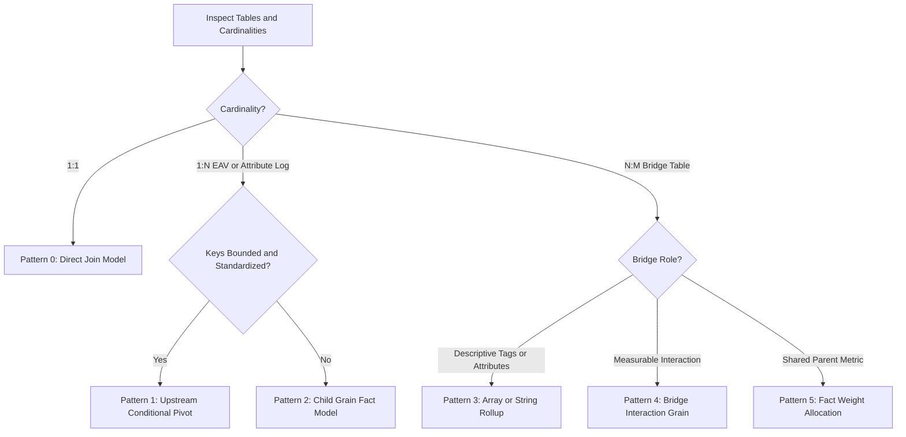

# Grain governance for multi-cardinality joins (Ariadne + historical Datus/OKF evidence)

Status: accepted (owner, 2026-09-15; scoped multi-fact planner revision approved by owner, 2026-09-30). Imported from selayer's ADR-0042 and adapted to Ariadne; independently confirmed by the fan-out trap (`datus-semantic-osi` 0.1.7 aggregates at joined-row grain — upstream issue [Datus-ai/Datus-agent#1426](https://github.com/Datus-ai/Datus-agent/issues/1426)).

**Decision, revised:** each **dataset** has exactly one declared and audited grain; a semantic model may contain multiple datasets. The existing guard rejects unsafe pre-joined/ad-hoc sources. The approved Ariadne-owned sqlglot planner may combine measures from different facts **only after independently aggregating each fact** and aligning on explicitly conformed dimensions. It never treats a conformed mapping as a raw fact join. Both a domain-style multi-dataset OSI file and separate single-dataset OSI files plus a cross-file graph normalize to the same planner graph; conflicting declarations fail. The [approved behavioral specification](../specs/2026-09-30-0008-multi-fact-planner.md) owns the query and audit requirements. The 2026-09-15 rules below still govern constructing a **single dataset source** and the existing ad-hoc path; their former one-grain-*per-model* and blanket no-multi-fact limitations are superseded by this scoped decision, not yet implemented.

**Alternatives:** continue forcing every requested multi-fact comparison into one flattened dataset (fails the order/line fan-out trap); import Datus execution (conflicts with [ADR-0008](0008-own-sqlglot-compiler-agpl-exit.md)); or implement parallel layout-specific planners (duplicates grain and safety policy). One normalized graph and independently aggregated branches retain source-layout choice without splitting semantics.

Related: [ADR-0005](0005-adhoc-validated-execution-invariant.md) (no-unvalidated-execution) · [ADR-0008](0008-own-sqlglot-compiler-agpl-exit.md) (own compiler) · [multi-fact specification](../specs/2026-09-30-0008-multi-fact-planner.md) · [CONTEXT.md](../../CONTEXT.md) (Grain, Fan-out, Conformed Dimension).

The original rubric and example audit protocol retain their section numbering for cross-project reference; read them with the revised single-dataset scope above.

---

## 1. Context & Architectural Constraints

### 1.1 The Engine Limitation (Apache Ossie / `datus-semantic-osi`)

The **historical external `datus-semantic-osi` engine**, not the approved Ariadne multi-fact planner, exhibits the following architectural behaviors:

1. **Joined-Row Execution Grain:** All declared metric expressions (aggregations) compile directly over the flattened, post-join tabular result set.
2. **Absence of Symmetric Aggregates:** The engine lacks automated fan-out protection (e.g., primary-key hashing, automatic subquery pushdown, or Looker-style symmetric aggregation).
3. **No Cross-Semantic-Model Federation:** Attempts to isolate tables across independent semantic models and query across them are rejected at runtime with:
   > *"Cross-semantic-model queries are not supported."*

### 1.2 The Failure Mode (Silent Aggregate Inflation)

When a single flattened dataset source joins non-isomorphic cardinalities (1:N or N:M), metrics belonging to the upper ("one" or "parent") grain are multiplied by the fan-out factor of the lower ("many") side. Merely placing that flattened source in a multi-dataset model does not repair it; separate fact branches do.

---

## 2. Decision & Core Principles

To guarantee sound analytics, agents **MUST NOT** rely on a raw multi-grain row join to calculate measures. Grain alignment and fan-out prevention occur in single-dataset source construction or in the validated multi-fact planner's separate aggregate branches.

### Golden Rules for Model Generation Agents

1. **Rule of Single Declared Dataset Grain:** Every dataset has exactly one declared grain. A model may group differently grained datasets, but never claim that their joined rows share a grain.
2. **Rule of Metric Ownership:** A base aggregate (`SUM`, `AVG`, `STDDEV`, `COUNT`) belongs to one owning dataset and may use measures native to its row grain. A parent-grain measure must not be computed over child rows; the planner may compute it in a separate parent branch.
3. **Rule of Safe Cardinality:** Resolve 1:N logs and N:M bridges before embedding them in a **single dataset source** used for duplicate-sensitive measures. Separately modeled facts may instead align their already aggregated results through explicit conformed dimensions. Dimension traversals require proven many-to-one/one-to-one cardinality.

---

## 3. Normative Resolution Patterns (Agent Decision Rubric)

When authoring a flattened **single dataset source**, agents classify its source relations and use an appropriate pattern below. For a multi-fact query, keeping the parent and child as separate audited datasets and aggregating each before alignment is now another permitted solution. The patterns do not authorize row-level parent/child joins for metrics.



---

### Pattern 1: Upstream Conditional Pivot (1:N Attribute / EAV Logs)

* **Trigger:** A parent entity (1) joins to a child table (N) where the child records represent discrete, repeated tests, parameters, or attribute keys (e.g., EAV structures, standardized test runs, order line status milestones).
* **Condition:** The attribute key domain is bounded, known, and standardized.
* **Agent Directive:**
  1. Construct an upstream view (dbt/SQL) that pivots child records into dedicated columns using conditional aggregation grouped by the parent entity primary key.
  2. Enforce deterministic qualification for re-runs/duplicates (e.g., `ROW_NUMBER() OVER (PARTITION BY entity_id, key ORDER BY timestamp DESC) = 1`).
  3. Join the parent entity table to the pivoted view (1:1 cardinality).
  4. Register the model at the **Parent Entity Grain**.

#### Examples

##### Typical E-Commerce / Orders Domain

* **Source:** `Orders` (1) -> `Order_Milestones` (N events: `PLACED`, `PAYMENT_CLEARED`, `SHIPPED`, `DELIVERED`).
* **Pivoted Columns:** `placed_at`, `payment_cleared_at`, `shipped_at`, `delivered_at`.
* **Grain:** 1 row per `order_id`.

##### Shopfloor / Manufacturing Domain

* **Source:** `Motor_Production` (1) -> `EoL_Tests` (N tests: `TORQUE`, `RELEASE_TIME`, `LEAKAGE`).
* **Pivoted Columns:** `holding_torque_nm`, `release_time_ms`, `leakage_ma`.
* **Grain:** 1 row per `motor_id`.

---

### Pattern 2: Child Grain Fact Model (1:N Unbounded / Dynamic Logs)

* **Trigger:** A parent entity (1) joins to a child table (N) where the child keys are unbounded, heterogeneous, or dynamic time-series.
* **Condition:** Pivoting into fixed columns is structurally unviable.
* **Agent Directive:**
  1. Define the semantic model strictly at the **Child Grain**.
  2. Denormalize parent attributes down into the child view strictly as **Dimensions** (categories/filters).
  3. **Strict Ban at child grain:** Do not register parent-level additive measures (`SUM`) on this child dataset; a separate parent-grain dataset may own and aggregate them.
  4. Parent entity counting **on these child rows** uses `COUNT(DISTINCT parent_id)`.

#### Examples

##### Typical E-Commerce / Orders Domain

* **Model Grain:** 1 row per `order_item_id`.
* **Allowed Measures:** `SUM(line_item_amount)`, `AVG(unit_discount)`, `COUNT(DISTINCT order_id)`.
* **Forbidden Measure:** `SUM(order_shipping_fee)` *(would multiply shipping fees by total items in order)*.

##### Shopfloor / Manufacturing Domain

* **Model Grain:** 1 row per `test_execution_id`.
* **Allowed Measures:** `AVG(measurement_value)`, `COUNT(*)`, `COUNT(DISTINCT motor_id)`.
* **Forbidden Measure:** `SUM(motor_unit_cost)`.

---

### Pattern 3: Array / Set Rollup (N:M Descriptive Bridge)

* **Trigger:** Two entities (A and B) relate via an associative table (N:M), where Entity B provides labels, categories, error codes, tags, or certifications for Entity A.
* **Agent Directive:**
  1. Do not join the bridge directly inside the Ossie dataset.
  2. In an upstream SQL view, group the bridge table by Entity A's primary key and roll Entity B attributes into a native `ARRAY` or delimited string (`STRING_AGG`).
  3. Register the model at Entity A's grain.
  4. Use array-containment functions for downstream semantic filtering.

#### Examples

##### Typical E-Commerce / Orders Domain

* **Entities:** `Products` (N) <-> `Product_Tags` <-> `Tags` (M).
* **Rollup:** `SELECT product_id, ARRAY_AGG(tag_name) AS tags FROM ... GROUP BY product_id`.
* **Grain:** 1 row per `product_id`. `SUM(inventory_value)` remains uncorrupted.

##### Shopfloor / Manufacturing Domain

* **Entities:** `Motors` (N) <-> `Motor_Operators` <-> `Operators` (M).
* **Rollup:** `SELECT motor_id, STRING_AGG(operator_id, ', ') AS operator_ids FROM ... GROUP BY motor_id`.
* **Grain:** 1 row per `motor_id`. `SUM(production_cost)` remains uncorrupted.

---

### Pattern 4: Bridge Interaction Grain (N:M Relationship Analytics)

* **Trigger:** The relationship between Entity A and Entity B represents an event or state possessing its own lifecycle metrics (e.g., cross-assignments, multi-party sessions).
* **Agent Directive:**
  1. Establish the model grain as the **Bridge Table Primary Key** (`pair_id` or `(a_id, b_id)`).
  2. Dimensions from both Entity A and Entity B are projected down as dimensional attributes.
  3. Metrics defined over Entity A or Entity B must strictly be `COUNT(DISTINCT)`.
  4. Additive metrics (`SUM`) are only permitted on numeric attributes belonging natively to the interaction itself.

#### Examples

##### Typical E-Commerce / Orders Domain

* **Entities:** `Campaigns` (N) <-> `Campaign_Customer_Bridge` <-> `Customers` (M).
* **Grain:** 1 row per `(campaign_id, customer_id)`.
* **Allowed Measures:** `COUNT(*)` (Engagements), `COUNT(DISTINCT customer_id)`, `SUM(interaction_duration_seconds)`.
* **Forbidden Measures:** `SUM(customer_lifetime_value)`, `SUM(campaign_total_budget)`.

##### Shopfloor / Manufacturing Domain

* **Entities:** `Motors` (N) <-> `Assembly_Bridge` <-> `Workstations` (M).
* **Grain:** 1 row per `(motor_id, workstation_id)`.
* **Allowed Measures:** `SUM(station_dwell_time_seconds)`, `COUNT(DISTINCT motor_id)`.

---

### Pattern 5: Fact Weight Allocation (N:M Metric Splitting)

* **Trigger:** An additive metric originating from an upper parent entity must be distributed across an N:M or 1:N relationship without inflating the total sum.
* **Agent Directive:**
  1. Upstream, calculate an analytic allocation coefficient:
     `weight = 1.0 / COUNT(*) OVER (PARTITION BY parent_id)`
  2. Compute an allocated metric column:
     `allocated_val = raw_metric_val * weight`
  3. Register `SUM(allocated_val)` as the certified metric in the semantic layer.

#### Examples

##### Typical E-Commerce / Orders Domain

* Splitting an order-level `shipping_cost` across individual order line items based on item value or equal fractional weight:
  `line_shipping_share = order_shipping_cost * (line_price / order_total)`

##### Shopfloor / Manufacturing Domain

* Splitting a supplier batch testing fee across all motors assembled from that batch:
  `allocated_batch_cost = batch_testing_fee * (1.0 / motors_per_batch_count)`

---

## 4. OKF Spec v0.2 Context Layer Integration

When the Context Layer Agent parses or produces schemas according to OKF Spec v0.2, it must populate context metadata with grain declarations and validation assertions.

### 4.1 Schema Metadata Extension (OKF Schema Decorator)

Every dataset node generated for `apache-ossie` consumption must declare its exact grain and verified cardinality mappings:

```yaml
schema_version: "okf-spec-v0.2"
id: "urn:dataset:production:motor_eol_flattened"
name: "motor_eol_flattened"
description: "Pivoted 1:1 view uniting motor assembly metadata with final test readings."

grain:
  primary_key: ["motor_id"]
  cardinality_enforcement: "STRICT_1_TO_1"

cardinality_audit:
  upstream_pattern: "PATTERN_1_CONDITIONAL_PIVOT"
  source_tables:
    - table: "raw.motor_production"
      role: "PARENT"
      cardinality: "1"
    - table: "raw.eol_tests"
      role: "CHILD_LOG"
      cardinality: "N"
      resolution: "PIVOT_ON_TEST_TYPE"

dimensions:
  - name: "motor_id"
    type: "string"
    is_primary_key: true
  - name: "brake_type"
    type: "string"
  - name: "brake_supplier_batch_id"
    type: "string"

measures:
  - name: "total_motors"
    expression: "COUNT(motor_id)"
    type: "additive"
  - name: "avg_holding_torque"
    expression: "AVG(holding_torque_nm)"
    type: "additive"
    grain_safe: true
```

---

## 5. Autonomous Audit Agent: Pre-Flight Verification Protocol

*Ariadne mapping: `ariadne/validate.py` performs the existing single-source pre-flight. The approved planner additionally requires per-dataset key checks, relationship-target uniqueness, conformance/reference checks, and runtime evidence relevant to each query; the [specification](../specs/2026-09-30-0008-multi-fact-planner.md) owns those conditions. A profiler's sampled unique ratio alone cannot prove a key.*

Before admitting a source dataset containing a flattened join, validate its grain against the physical source; the original illustrations follow:

### Assertion 1: Uniqueness Test (Grain Verification)

Verify that the proposed dataset grain is strictly distinct:

```sql
SELECT 
    COUNT(*) AS total_rows,
    COUNT(DISTINCT {declared_primary_key}) AS distinct_keys
FROM {candidate_dataset_or_view};
```

* **Failure Condition:** a duplicate full declared key tuple **or any NULL key component**. The SQL above illustrates a single-column key; composite keys require grouping by the complete tuple and checking every component for NULL.
* **Remediation:** Halt admission. Pivot, choose a truthful child grain, or separately model another fact branch as appropriate.

### Assertion 2: Parent Aggregate Invariance Test

When a candidate **single source** includes a parent-grain additive measure, ensure it has not undergone fan-out inflation. A separately aggregated parent branch is checked by the planner's independent trap oracle instead:

```sql
WITH baseline AS (
    SELECT SUM({parent_metric}) AS original_sum FROM {raw_parent_table}
),
modeled AS (
    SELECT SUM({parent_metric}) AS post_join_sum FROM {candidate_dataset_or_view}
)
SELECT 
    b.original_sum, 
    m.post_join_sum,
    (m.post_join_sum - b.original_sum) AS divergence
FROM baseline b, modeled m;
```

* **Failure Condition:** `divergence != 0`.  
* **Remediation:** Remove `{parent_metric}` from model measures or apply Pattern 5 (Weight Allocation).

---

## 6. Summary: Agent Implementation Contract

| Step | Agent Responsibility | Output Artifact |
| :--- | :--- | :--- |
| **1. Inspection** | Inspect primary keys, foreign keys, and cardinalities across tables. | Cardinality Graph |
| **2. Pattern Selection** | Apply the Decision Rubric to select Pattern 1, 2, 3, 4, or 5. | Architecture Decision Log |
| **3. Upstream DDL** | Emit dbt model / SQL view containing pivots, rollups, or allocations. | Transformed View SQL |
| **4. Pre-Flight Audit** | Execute Assertions 1 & 2 against target data. | Verification Result (Pass/Fail) |
| **5. OSI Config** | Emit OSI YAML with one grain per dataset and unambiguous metric owners; a model may include several separate datasets. | `semantic_layer/models/*.yml` |
| **6. OKF Decoration** | Document semantic grain, cardinality resolution, and metadata. | `okf_context_v02.json/yaml` |

*Ariadne mapping: Inspection → `ariadne/profiler.py` · Pattern Selection → authoring guidance plus `define_metric` rejection (single-dataset path), or separately modeled fact branches in the approved planner · Upstream DDL → only when a dataset source needs flattening · Pre-Flight Audit → `ariadne/validate.py` and the new graph checks specified above · OSI Config → `semantic_layer/` · OKF Decoration → `context_layer/` pages. This mapping describes an approved design, not completed planner implementation.*
